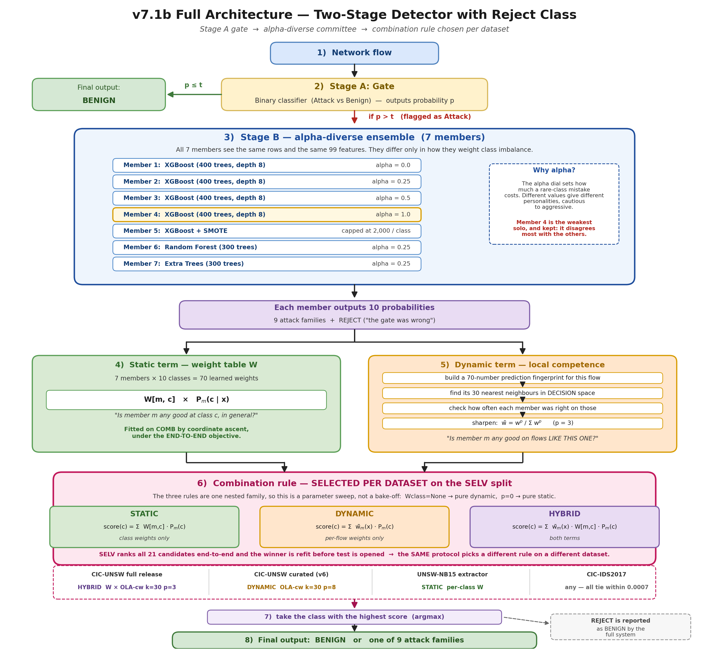

# The v7.1b Intrusion Detection Architecture — An Explanatory Report

**A walkthrough of `final_model_v7_1_reject_stages.ipynb`**
CIC-UNSW-NB15-2024, full CICFlowMeter release (3,540,241 flows)

This document sets out *what the system is and why each component is present*, in accessible
language. It is a companion to the notebook rather than a summary of it: the notebook presents the
code and the measurements, while this document presents the reasoning behind them. No prior
knowledge of the project is assumed; every technical term is defined on first use, and a glossary
is provided at the end.

**Headline result: macro-F1 0.689 [0.672, 0.704], accuracy 0.9866.**

---

## 1. Problem statement

A network flow is a summary of one conversation between two machines — how long it lasted, how many
packets went each way, how big they were, how they were spaced in time. A tool called CICFlowMeter
turns raw network traffic into a table of 76 such numbers per flow.

The job: given those numbers, decide whether the flow is **normal traffic** or **one of nine attack
families** (Analysis, Backdoor, DoS, Exploits, Fuzzers, Generic, Reconnaissance, Shellcode, Worms).
Ten possible answers in total.

Three things make this hard, and every design decision in the notebook traces back to one of them.

**(a) The classes are wildly unequal.** After cleaning, 96.87% of flows are benign. Worms has 243
flows in the entire 2.6-million-row dataset — a ratio of **10,392 : 1**. A model that answers
"benign" every single time scores 96.87% accuracy and is completely useless. This is why the primary
metric here is **macro-F1**, which averages performance over the ten classes *equally*, so Worms
counts as much as Benign. Accuracy is reported alongside it, but never on its own.

**(b) There are a lot of duplicate rows.** 26.37% of the raw file consists of flows that are
byte-for-byte identical to another flow. If duplicates are left in, the same flow can appear in both
the training data and the test data — so the model is tested on rows it has already memorised, and
scores near 100%. This does not indicate a capable model; it indicates an invalid experiment. The notebook removes
duplicates *first*, before anything is split or trained.

**(c) Some attacks genuinely look like normal traffic.** This is the most consequential of the three. Earlier work in this
project measured how often a flow's nearest neighbour in the data carries a *different* label, and
found roughly 21–38% of attack flows sit in regions where the families overlap. No classifier can
separate what the measurements do not distinguish. Much of this notebook is concerned with
managing that overlap rather than disregarding it.

---

## 2. System overview



**Figure 1 — the full v7.1b architecture.** A flow enters at the top; the gate either clears it as
Benign or passes it to the seven-member committee; the committee's ten probability vectors are
merged by a combination rule, and the winning class is the answer. The one part of the picture that
is *not* fixed in advance is box 6: **Static, Dynamic and Hybrid are three candidate rules, and
which one the system uses is chosen per dataset** on the SELV split. See §5.3.

The pipeline operates as a two-tier triage process. **Stage A** performs the initial screening: it
examines every flow and determines only whether that flow warrants further investigation. **Stage
B** performs the specialist assessment: it sees only the flows Stage A has flagged, and determines
which attack family they belong to. The **REJECT** output is the mechanism by which Stage B can
indicate that Stage A's decision was incorrect and the flow should be returned to Benign.

---

## 3. Preparing the data (Stages 1–2 of the notebook)

### 3.1 Loading, and the columns deliberately excluded

The full release ships one file with seven metadata columns in front (`Flow ID`, `Src IP`,
`Src Port`, `Dst IP`, `Dst Port`, `Protocol`, `Timestamp`), then the 76 measurements, then the label.

Two of those metadata columns are **kept as features**: `Dst Port` and `Protocol`.
Five are **deliberately excluded**: `Flow ID`, `Src IP`, `Dst IP`, `Src Port`, `Timestamp`.

The reason is worth stating clearly, because it is a correctness issue and not a preference.
Source IP identifies *which machine* sent the traffic. In a lab testbed the attack machines and the
benign machines are different machines, so "which machine" predicts the label almost perfectly — and
predicts nothing at all on a real network, where the attacker's address is not known in advance.
A model relying on source IP would therefore score highly in evaluation while providing no
operational value. Destination port is different: it
says *what service was targeted*, and attacks genuinely target specific services. That is behaviour,
not identity, so it is allowed in.

*(The same test was later applied to TTL values recovered from the original UNSW files. TTL failed
it — it turned out to encode which machine generated the traffic — and was rejected despite raising
the score. See `results/ttl_join/`.)*

### 3.2 Removing duplicates

933,438 rows (26.37%) are exact duplicates. They are dropped, leaving **2,606,803 rows**.

A useful by-product: comparing "duplicates counted on features only" with "duplicates counted on
features *and* label" reveals rows whose measurements are identical but whose labels disagree —
flows the data itself cannot tell apart. There are only **523 of them (0.015%)**, which is good
news: the difficulty in this dataset is not mislabelled data, it is genuine overlap between classes.

### 3.3 Choosing features — three blocks, 99 columns

**Block 1 — the pruned originals (43 columns).** Two label-free checks are run on the 76 raw
measurements:

- **Constant columns.** Nine columns have the same value in every row (e.g. `Bwd PSH Flags` is
  always 0). A column that never changes cannot help distinguish anything. Dropped. 76 → 67.
- **Redundant columns.** Some pairs of columns are near-perfect copies of each other — for instance
  `Bwd Packet Length Mean` and `Bwd Segment Size Avg` correlate at 1.000, and `Flow Duration` with
  `Fwd IAT Total` at 0.999. For each such pair the second column is dropped. 67 → **43**.

Both checks look only at the measurements, never at the labels, so they can safely run before the
data is split (see §5.1 for why that matters).

**Block 2 — engineered ratios (31 columns).** The raw measurements are all *absolute*: a flow that
ran for ten minutes has big numbers simply because it ran for ten minutes. Ratios remove that.
Examples: forward-to-backward packet ratio, bytes per packet, how variable the packet gaps are, and
— importantly — **flags expressed as a fraction of packets** rather than a raw count.

To illustrate: "400 PSH flags were sent" reports mainly how long the conversation was, whereas
"60% of packets carried a PSH flag" characterises what *kind* of conversation it was. The second travels across flows of
different sizes; the first does not.

These are built from the **unpruned** 67 columns, not the pruned 43 — a column dropped for being a
linear copy of another can still contribute something new inside a ratio.

**Block 3 — service identity (25 columns).** `Dst Port` and `Protocol` turned into readable
features: one-hot flags for 20 well-known services (`svc_http`, `svc_dns`, `svc_smb`, `svc_rpc`, …),
three port-range bins, two protocol flags, and the raw port number.

**This block is the single largest gain in the whole project (+0.098 macro-F1, measured by
ablation).** The reason is simple once stated: attacks target services. Reconnaissance probes RPC on
port 111; Fuzzers hammer BGP on 179 and SMB on 445; Shellcode arrives on high ephemeral ports.
Before these columns existed, the model had to infer "this is a DNS flow" from timing and size
patterns, which it could not do. Now it is told directly.

**Total: 43 + 31 + 25 = 99 features.**

---

## 4. The four architectural decisions

Each was adopted **because a measured alternative failed**. This framing is more defensible in a
thesis than a post-hoc account of why each choice was self-evident.

### Decision 1 — Two stages instead of one ten-class model

The obvious design is one model with ten outputs. The notebook instead splits the job in two.

The reason is that the two halves of the problem have wildly different difficulty. Telling attack
from benign is nearly solved: the gate achieves **98.8% attack recall**. Telling one attack family
from another is where everything goes wrong. Putting them in one model means the easy half dominates
training — the model spends its capacity on a question it has already answered.

Splitting them lets each half be tuned for its own job, and puts the effort where it pays.

*Caveat, stated up front: the hierarchy is not established as a standalone improvement. Under one
weighting scheme it measured −0.006 (not significant). It is significant only in combination with
the tempered weighting of Decision 3 (+0.018, p=0.005). The honest claim is "hierarchy plus
tempered weighting", as an interaction — never "the hierarchy helps".*

### Decision 2 — The reject class (the contribution this notebook tests)

This is the idea the notebook exists to evaluate, and it is best explained through the problem it
solves.

The gate is excellent at recall but its precision is only **0.654**. In a dataset that is 96.9%
benign, 1.7% of benign flows getting through is a *large absolute number* — 34,101 flows in the
training half alone. Every one of them lands in front of Stage B.

And in the previous version (v7), Stage B had only nine outputs: nine attack families. It was
**structurally incapable** of saying "this isn't an attack". Handed an innocent flow, it was forced
to pick an attack family for it. The result was 8,370 benign flows labelled as attacks on the test
set — a false-alarm flood, most of it landing in the Fuzzers class.

The fix is to add a **tenth class**. Its training data is defined without leakage (§5.2): the
34,101 benign flows that fooled a version of the gate that had never seen them. Stage B now learns
the characteristics of a gate false positive as a class in its own right. At inference, anything Stage B
assigns to the reject class is reported as **Benign**.

**Result: benign-flagged-as-attack drops from 8,370 to 3,270 — roughly 4× fewer false alarms —
and the paired improvement is +0.0265 macro-F1, established at p < 0.001.**

**This is a trade-off rather than an unqualified improvement, and both sides must be reported
together.**
On the test set the reject class sends 5,643 flows back to Benign. **4,113 of them are genuinely
benign** (false alarms eliminated — the benefit). **1,530 of them are real attacks** (detections lost — the cost). The net effect is clearly positive, but it remains a net effect.

The deeper point: the Fuzzers/Benign boundary is genuinely inseparable in this feature space. The
reject class does not remove it. What it provides is **explicit control over which error type is
incurred** — a high volume of false alarms, or a lower alert volume that misses some genuine
attacks. That is a security-operations decision rather than a modelling one, and it should be
presented as such.

### Decision 3 — A committee of seven, diversified by *class weighting*

Stage B is not one model but seven, voting.

The standard way to build a committee is to use different *algorithms* — a decision tree, a neural
network, a nearest-neighbour model — on the theory that different algorithms make different
mistakes. **That was tried in this project and it failed**: the models agreed with each other almost
all the time, so averaging them added nothing.

What worked instead was diversifying along the **class-weighting axis**. During training you can
tell a model how much a mistake on a rare class hurts relative to a mistake on a common one. That
dial is called **alpha**:

| Member | What alpha does | Worms is worth this much more than Exploits | Solo macro-F1 | Disagreement |
|---|---|---|---|---|
| XGB alpha=0.0 | ignore imbalance entirely | 1.0× | 0.6234 | 0.078 |
| XGB alpha=0.25 | mild correction | 3.4× | 0.6316 | 0.075 |
| XGB alpha=0.5 | moderate correction | 11.3× | 0.6326 | 0.081 |
| XGB alpha=1.0 | full correction (sklearn's `balanced`) | 127.5× | 0.6258 | **0.120** |
| XGB SMOTE-2000 | invent synthetic rare-class examples, capped at 2,000 | — | 0.6287 | 0.079 |
| RF alpha=0.25 | same dial, bagged trees | 3.4× | 0.6269 | 0.093 |
| ET alpha=0.25 | same dial, randomised splits | 3.4× | 0.6153 | 0.113 |

An alpha=0 model is conservative: it rarely calls something Worms, and is usually right when it does.
An alpha=1.0 model is aggressive: it calls Worms often, catching more of them and raising more false
alarms. These are genuinely different behaviours, and the combiner is able to exploit the
differences between them.

**A counter-intuitive but important observation:** member 4 (alpha=1.0) is one of the
*weakest* models individually — 0.6258 against 0.6326 for the best — and it is kept anyway, because
it **disagrees with the rest far more than they disagree with each other** (0.120 vs ~0.075–0.093).
An ensemble whose members agree is equivalent to a single model at greater computational cost. **Pool members are
chosen for complementarity, not individual quality.**

It is also worth noting that `balanced` weighting — the conventional default — is a **poor choice
here**. It ranked 12th of 14 weighting schemes tested, *below using no weighting at all*.
The useful range turned out to be a 3–11× rare-class emphasis where `balanced` demands 128×. The
general principle the project settled on is **moderate rebalancing, not full rebalancing** — and it
holds for oversampling as well as for weights (full SMOTE made things markedly worse, −0.072).

### Decision 4 — A constrained combiner, not a meta-classifier

Each of the seven members produces ten probabilities, and these must be merged into a single
answer. The notebook uses:

```
score(flow, class c) = SUM over members m of   Wd[flow, m]^p  ×  W[m, c]  ×  P_m(c | flow)
```

then picks the highest-scoring class. Two weights:

- **`W`** — a fixed 7×10 table of 70 numbers encoding the *general* reliability of member m on
  class c. Fitted by coordinate ascent: each weight is evaluated against a small grid of candidate
  values, any improvement is retained, and the procedure sweeps the matrix three times.
- **`Wd`** — a per-flow weight encoding the reliability of member m in the local region occupied by
  the flow being classified. Computed from the 30 most similar flows in a reference set, by
  recording which members classified those neighbours correctly.

The similarity lookup warrants comment, since it is not the obvious choice. Two flows count as
neighbours when **the seven members produce a similar pattern of probabilities about them** — not
when their raw measurements are similar. This is called *decision space*. It works better because it
addresses the relevant criterion directly — whether a comparable pattern of committee disagreement
has been encountered before — rather than whether a flow with similar raw byte counts has been seen.

**The obvious alternative, a meta-classifier, was evaluated and rejected.** Stacking — training a
second model to combine the outputs of the first seven — was tested earlier in the project. A meta-XGBoost scored **0.9178 on the data it was fitted
on and 0.5930 on test**, at *exactly the same parameter count* as the weight matrix that beat it.
The difference is not capacity, it is **inductive bias**: the constrained weighted-vote form cannot
express the highly flexible functions that allow stacking to memorise its fitting set. When the data available for
fitting the combiner is small relative to what a flexible model can absorb, a constrained combiner
is the better choice.

### 4.5 The modification that defines v7.1b

`W` is fitted **twice, under two different objectives**, with zero change to the architecture and
zero extra parameters:

- **The Stage-B objective** — maximise macro-F1 over Stage B's own ten classes, where "reject"
  counts as one tenth of the score.
- **The end-to-end objective** — maximise the macro-F1 the *deployed system* actually produces,
  with reject folded back into Benign and gate-negative flows entering as fixed background.

These are not the same target. Getting a reject correct barely moves Benign's F1 (Benign has ~505k
test rows; a few thousand either way is noise). But swallowing a real attack costs that family's
recall directly, and rare families have very few rows to lose.

Optimising the first objective quietly over-values the reject class. Optimising the second gets it
right. On the fitting half the score goes 0.6875 → **0.6906**; on test, **+0.0036
[+0.0020, +0.0056], p < 0.001**.

**A detail worth quoting because it is instructive:** re-fitting under the end-to-end objective left
the **reject column of `W` unchanged**. The optimiser rebalanced the nine *family* columns instead.
The operating point lives in the whole matrix, not in the one column you would have guessed.

**The general lesson, which costs nothing to apply anywhere else: fit the combiner on the objective
you will be judged on, not on the sub-problem's objective.**

---

## 5. Experimental protocol and safeguards

This section is what distinguishes a measured result from an unsupported claim, and it merits as
much space in the thesis as the architecture itself.

### 5.1 Label-dependent steps run only after the split

The fixed ordering is:

```
label-free prune  →  remove duplicates  →  stratified train/test split  →  everything else
```

The variance and correlation checks (§3.3) look only at the measurements, so they may run on the
full dataset. Anything that consults the labels — selecting features by relevance, training,
resampling — runs strictly on the training side. Violating this is the most common way published
NIDS numbers get inflated, and it is invisible in the final figure.

The split is **stratified**, meaning each class keeps its proportion on both sides. With 243 Worms
flows in total, an unstratified random split could easily leave almost none in the test set.

Result: **train+val 2,085,442 rows** (65,191 attacks, 3.13%), **test 521,361 rows** (16,298 attacks,
3.13%).

### 5.2 Cross-fitting — defining the reject class without leakage

The reject class is defined as "benign flows the gate got wrong". The naive way to find them is to
train the gate, run it on its own training data, and collect the mistakes. That does not work: a
model is unrealistically good on data it has memorised, so you would find far too few mistakes, and
the wrong ones.

Instead the gate is trained **five times**, each time holding out a fifth of the data, and each flow
gets its probability from the version that never saw it. These are **out-of-fold (OOF)**
predictions. They give an honest picture of which benign flows a *fresh* gate would get wrong.

**Reject set: 34,101 flows, 1.688% of benign train+val.** Stage B is therefore trained on 65,191
attacks + 34,101 reject = 99,292 rows.

The same cross-fitting is applied to the seven pool members, so the combiner learns from predictions
that are honest about each member's weaknesses. Fitted on in-sample predictions, every member looks
flawless and there is nothing left to tell them apart.

### 5.3 Three splits for three distinct fitting and selection tasks

| Split | Size | What it is used for |
|---|---|---|
| **COMB** | 1,042,721 | fit the combiner weights `W`; serve as the k-NN reference set |
| **SELV** | 1,042,721 | rank 21 candidate combination rules, and the gate threshold |
| **test** | 521,361 | the reported number — touched **once**, at the very end |

The additional split is necessary because, even when all 21 candidate rules are scored fairly on
SELV, *the winner of 21 comparisons* is optimistically biased — part of its margin reflects
sampling variation rather than genuine superiority. Selecting on SELV and reporting on test removes
that bias.

Crucially this costs **no training data**. All seven base models still train on the full 2,085,442
rows. COMB/SELV only decides where the *combining* step is fitted.

The selection ran, chose **`HYBRID W × OLA-cw k=30 p=3`** (SELV 0.6717), then swept the gate
threshold on that winner alone and picked **t = 0.7**. Everything was then refit on all of train+val
before the test set was opened.

Two things the selection table itself shows, worth reading off it:

- The five hybrid rules and the plain static `W` occupy the top six places (0.6689–0.6717) while
  every purely dynamic rule sits below them (0.6506–0.6594). **The per-class weight table is doing
  the work; the per-flow term adds a little on top.**
- The gate threshold barely matters — all five values span **0.0034**. Once the reject class exists,
  the threshold is a near-null lever, because the reject class does the same job better.

**Rationale for presenting the combiner as a selection step rather than a fixed component.** Static, Dynamic and
Hybrid are not three rival designs — they are one nested family of rules. Setting the per-class term
aside gives pure Dynamic; setting the sharpening exponent `p = 0` recovers pure Static *exactly*
(verified on 100.0000% of rows). The selection step is therefore a parameter sweep, and the accurate
way to describe the architecture is: **the protocol selects the rule, and it selects differently on
different data.**

| Dataset | What SELV picked | Why |
|---|---|---|
| CIC-UNSW full release (this notebook) | **HYBRID** `W × OLA-cw k=30 p=3` | ten-class problem is hard enough that both terms pay |
| CIC-UNSW curated subset (v6) | **DYNAMIC** `OLA-cw k=30 p=8` | purer engineered features made neighbourhoods informative |
| UNSW-NB15 extractor | **STATIC** per-class `W` | different representation; the per-flow term stopped helping |
| CIC-IDS2017 | any — **all 17 variants tie within 0.0007** | the problem is near-separable, so combination is irrelevant |

That last row is a finding in its own right, not a footnote: **the architecture's value is
conditional on the problem being hard.** On an easy dataset a plain ExtraTrees matches the full
stack. Reporting the elaborate architecture without that caveat would overstate what it buys.

### 5.4 Paired bootstrap — establishing which differences are real

A point estimate such as 0.6887 is uninformative in isolation: a different random split might
yield 0.68 or 0.70. So the test set is resampled 2,000 times (stratified by class), and **both** configurations
being compared are scored on the **same** resample each round, so shared luck cancels out.

This yields two distinct yardsticks, and conflating them is a common source of error:

- **Reporting one configuration:** the interval is roughly **±0.017**. Quote as
  `0.689 [0.672, 0.704]` — never four decimals.
- **Comparing two configurations on the same test set:** the paired interval is tighter, roughly
  **±0.012** for arms of this kind, because everything the two arms share cancels.

*One warning carried from elsewhere in the project: ±0.012 is not a universal constant. It shrinks
as the two arms share more machinery — in one comparison where the arms differed only in the gate,
the paired interval was ±0.0025 and a −0.0038 difference was significant. Always compute the paired
interval for the specific comparison at hand.*

A result counts here only when its **whole interval clears zero**.

---

## 6. Results

### 6.1 Headline

| Metric | Value |
|---|---|
| **macro-F1 (primary)** | **0.6887** → quote as **0.689 [0.672, 0.704]** |
| Accuracy | 0.9866 |
| ROC-AUC (macro, one-vs-rest) | 0.9644 |
| Macro precision / recall | 0.7117 / 0.6895 |
| Weighted precision / recall / F1 | 0.9880 / 0.9866 / 0.9872 |

The gap between the macro (0.689) and weighted (0.987) figures summarises the central difficulty of
this dataset: the system performs excellently on the most frequent traffic and only moderately on
the rarest. Reporting the weighted figure alone would misrepresent the system's behaviour.

*(A note on the ROC-AUC: this is a pipeline, not a single probabilistic classifier, so a ten-class
probability has to be constructed for the metric to mean anything. It is built by soft routing —
`P(family k) = p_attack × q_k`, `P(Benign) = (1 − p_attack) + p_attack × q_reject` — with
gate-negative rows emitting a hard Benign, exactly as the deployed system behaves. The number
therefore reflects the gate's hard rejection rather than papering over it.)*

### 6.2 The improvement ladder

All configurations scored on the same test rows, each with its own combiner fitted by the same
procedure, so the comparison is fair:

| Configuration | macro-F1 | accuracy |
|---|---|---|
| v7 — nine-class Stage B (no reject) | 0.6584 | 0.9798 |
| v7.1 — + reject class | 0.6848 | 0.9873 |
| v7.1b — + end-to-end combiner objective | 0.6884 | 0.9865 |
| **FINAL (SELV-selected rule and threshold)** | **0.6887** | **0.9866** |

Paired bootstrap, 2,000 resamples:

| Comparison | Δ macro-F1 | 95% CI | verdict |
|---|---|---|---|
| reject class vs 9-class baseline | **+0.0265** | [+0.0172, +0.0359] | **established** (p ≈ 0.000) |
| e2e objective vs Stage-B objective | **+0.0036** | [+0.0020, +0.0056] | **established** (p ≈ 0.000) |
| FINAL vs 9-class baseline | **+0.0304** | [+0.0211, +0.0404] | **established** (p ≈ 0.000) |

### 6.3 Per-class results and the source of the improvement

| Class | Test rows | F1 (v7) | F1 (final) | Δ |
|---|---|---|---|---|
| Benign | 505,063 | 0.9915 | 0.9949 | +0.0034 |
| Analysis | 77 | 0.1571 | 0.1605 | +0.0034 |
| Backdoor | 90 | 0.6582 | 0.6579 | −0.0003 |
| DoS | 884 | 0.5642 | 0.6082 | +0.0440 |
| Exploits | 6,185 | 0.8002 | 0.8234 | +0.0232 |
| Fuzzers | 5,287 | 0.5982 | 0.6396 | +0.0414 |
| Generic | 899 | 0.8764 | 0.8788 | +0.0023 |
| Reconnaissance | 2,407 | 0.8201 | 0.8240 | +0.0039 |
| **Shellcode** | 420 | 0.5042 | **0.7253** | **+0.2211** |
| Worms | 49 | 0.6136 | 0.5743 | −0.0394 |

**Shellcode is the big winner (+0.221)**, and the mechanism is clean: Shellcode arrives on high
ephemeral ports, which is exactly where the gate's benign false positives also live. Before the
reject class, that flood of innocent flows was dumped into Shellcode and destroyed its precision.
With somewhere else to put them, precision recovers.

Two honest counterweights:

- **Analysis remains very weak (F1 0.161).** Only 77 test rows, and its flows genuinely look like
  benign leakage — 47 of them are sent back to Benign. Report it as an interval, not a point.
- **Worms went down (−0.039) on 49 test rows.** At that support the confidence interval is roughly
  ±0.13, so this movement means nothing on its own. It should not be presented as a cost of the
  reject class — and equally, the project's earlier *gains* on Worms should not be presented as wins.

### 6.4 Operational interpretation

| Quantity | Value |
|---|---|
| Alerts raised on the test set | 17,667 |
| Genuine attacks among them | 14,397 |
| **False alarm rate among alerts** | **19%** — about 1 in 5 |
| Benign flows wrongly alerted | 3,270 (v7: 8,370) |
| Real attacks sent back to Benign | 1,530 |
| Gate attack recall @ t=0.7 | 0.9772 |
| Gate precision @ t=0.7 | 0.6833 |

For context, the equivalent figure on the curated 447k subset was approximately 1 false alarm in
16; at the *actual* 96.9% benign base rate it is 1 in 5. This is why the full release matters: it
constitutes the realism stress test, and 1-in-5 is the rate an analyst would encounter in
practice.

---

## 7. Computational cost and deployment requirements

| Step | Time |
|---|---|
| Full notebook, caches present | ~12 min |
| Full notebook, cold | ~45 min |
| Gate refit | 0.7 min |
| 9-class baseline pool refit | 1.8 min |
| 10-class reject pool refit | 3.8 min |

Deployment on live traffic requires three components:

1. the refit gate and the seven-member reject pool (8 models),
2. the 7×10 weight matrix `W` (70 numbers),
3. **the k-NN reference set** — the COMB probability profiles held in memory, needed by the
   per-flow `Wd` term.

Item 3 is the real cost of the dynamic combiner: a nearest-neighbour query per flow, against a large
in-memory reference set. If inference budget were tight, the purely static rule
(`STATIC: per-class W`, SELV 0.6689 against the winner's 0.6717) gives up very little and drops the
reference set entirely. **That is the recommended deployment configuration** unless the last 0.003
outweighs the memory requirement.

The notebook's Stage 7 wraps the whole path in one function, `classify_flows(X_new, threshold)`,
which returns the predicted label, the class name, and the gate's attack probability for each flow.

---

## 8. Limitations and caveats

**1. The reject class is an operating choice, not a fix.** It cancels 4,113 false alarms and loses
1,530 real detections doing it. Always report both columns.

**2. The Fuzzers/Benign boundary inverts, it does not dissolve.** Fuzzers precision improves sharply
but its recall drops, because the reject class swallows real Fuzzers flows along with the benign
ones. The two classes are inseparable in this representation; the reject class only decides which
side pays.

**3. The reject class is also an attack surface.** Later robustness work
(`results/v73f_misattribution/`) found that an adversary aiming to corrupt *labels* rather than
evade detection finds the reject class as the cheapest route: under that attack essentially every
missed detection is a reject-class abstention rather than a gate miss. The +0.0265 gain and this
surface should always be reported together.

**4. Single dataset.** Everything here is one capture campaign. Attacks in this testbed target
specific services, so the service-identity features may be partly a testbed artifact. A cross-network
claim needs evidence this notebook does not contain.

**5. Rare classes carry wide uncertainty.** Worms 49 test rows, Analysis 77, Backdoor 90. Movements on these
classes below roughly ±0.1 F1 mean nothing individually, even when the macro average is solid.

**6. Run-to-run jitter.** This staged notebook reports 0.6887 where the earlier v7.1b run reported
0.6874 — roughly ±0.0014 of XGBoost threading jitter, not a change in the method. The paired deltas
in §6.2 are measured against a same-run baseline, so they are unaffected. Quote
`0.689 [0.672, 0.704]`.

---

## 9. Alternatives evaluated and rejected

This section is included because the adequacy of tuning is a standard examination question, and
because the negative results are collectively a stronger finding than any single positive one.

**Established (each with an interval clearing zero):**

| Lever | Gain |
|---|---|
| alpha = 0.25 weighting, over `balanced` | +0.0385 |
| Derived ratio features | +0.0101 |
| Service identity (port / protocol) | **+0.0982** |
| Hierarchy + reject class | +0.0242 |
| End-to-end combiner objective | +0.0032 |

**Not established:**

| Lever | Outcome |
|---|---|
| Full SMOTE balancing | worse (−0.072) |
| Focal / dynamic weighting | worse; collapses entirely at gamma=2 |
| Algorithm-diverse ensemble pool | null |
| Per-class thresholds, soft routing | null — algebraically redundant with `W` |
| Gate re-weighting and gate threshold | null (+0.0006) |
| Wider alpha grid (1.5, 2.0) | null — the axis saturates at 1.0 |
| Second-round feature algebra (38 more columns) | null |
| **XGBoost hyperparameter sweep** | +0.0054, **interval crosses zero — not established** |
| Reject-set enrichment | null (+0.0009) |
| TTL from the original UNSW files | rejected — a label proxy, not behaviour |

**The pattern is the finding.** Every gain in this project came from **weighting, information, or
objectives**. Not one came from **capacity** — not bigger models, not more ensemble members, not
hyperparameter tuning, not dynamic model selection. All of those were tested; none is established.

Two entries merit particular emphasis:

- **Hyperparameter tuning *looks* like a bigger win than the end-to-end objective** (+0.0054 vs
  +0.0032) and is the one that cannot be claimed, because its interval crosses zero. Point estimates
  without intervals would have led to exactly the wrong conclusion.
- **TTL was excluded despite raising the score**, because it encodes which machine generated the
  traffic rather than what the traffic did. Rejecting a feature that helps is the harder call, and
  the more defensible one.

---

## 10. Notebook structure

| Section | Cells | What happens |
|---|---|---|
| 1. Data Collection | 2–3 | Load 3.54M flows; keep `Dst Port`/`Protocol`, drop IP/timestamp |
| 2.1–2.2 Duplicates | 4–7 | 26.37% dropped → 2,606,803 rows |
| 2.3 Class distribution | 8–9 | Benign 96.87%; imbalance 10,392:1 |
| 2.4–2.6 Feature prune | 10–16 | 76 → 67 → 43, label-free |
| 2.7 Engineered ratios | 17–18 | +31 scale-free columns |
| 2.8 Service identity | 19–20 | +25 columns → 99 total |
| 2.9 Train/test split | 21–22 | Stratified 80/20 |
| 2.10 COMB/SELV split | 23–24 | Fitting vs selection halves |
| 3. Model Selection | 25–26 | The 7-member pool and the alpha dial |
| 4.1 Gate cross-fit | 27–28 | OOF probabilities; recall 0.988 / precision 0.654 |
| 4.2 Reject class | 29–30 | 34,101 gate false positives become class 10 |
| 4.3 Pool cross-fit | 31–32 | OOF probabilities for all 7 members |
| 4.4 Combiner | 33–35 | `W` fitted under both objectives |
| 4.5 Rule selection | 36–38 | 21 rules on SELV; gate threshold sweep |
| 4.6 Refit | 39–40 | Everything refit on all train+val |
| 5. Evaluation | 41–46 | Test metrics, confusion matrix, reject accounting |
| 6. Improvement | 47–51 | Ladder, paired bootstrap, closed levers |
| 7. Prediction | 52–53 | `classify_flows()` inference path |

---

## Glossary

**Flow** — a summary of one conversation between two machines, expressed as numbers.

**Macro-F1** — the average of the per-class F1 scores, with every class weighted equally. It is
the primary metric here because it prevents the 96.9% benign majority from masking failures on rare
attack classes.

**Precision / recall** — of the flows the model called class X, what fraction really were X
(precision); of the flows that really were X, what fraction did it catch (recall). A model can be
made good at either by sacrificing the other, which is why both are always shown.

**Stratified split** — a train/test division that preserves each class's proportion on both sides.

**Leakage** — any way information about the test set influences training. Duplicate rows and
label-aware preprocessing before the split are the two common routes.

**Out-of-fold (OOF) prediction** — a prediction for a row made by a model version trained without
that row. This is the only unbiased way to observe how a model behaves on data it has not
memorised.

**alpha** — the class-weighting exponent. alpha=0 ignores imbalance; alpha=1 is sklearn's
`balanced`. This project found the useful range to be around alpha=0.25.

**SMOTE** — a technique that invents synthetic examples of rare classes by interpolating between
real ones. Used here in one pool member only, capped at 2,000 rows; balancing everything fully with
it made results substantially worse.

**Coordinate ascent** — a simple optimiser: change one number at a time, keep the change if the
score improves, repeat.

**Decision space** — comparing flows by *the pattern of probabilities the committee assigns them*
rather than by their raw measurements.

**OLA (Overall Local Accuracy)** — a per-flow competence estimate: how often each member was right
on the k most similar flows. `OLA-cw` weights rare-class neighbours more heavily.

**Paired bootstrap** — resampling the test set many times and scoring both configurations on the
*same* resample each round, so shared luck cancels and only the genuine difference remains.

**Base rate** — how common attacks are in the traffic. The curated subset ran at 20% attacks; the
full release runs at 3.1%, which is realistic and much harder.

---

*Source notebook: `final_model_v7_1_reject_stages.ipynb`. Related: `results_summary.md` for the full
experimental record, `robustness_chapter.md` for the adversarial and drift analysis.*
